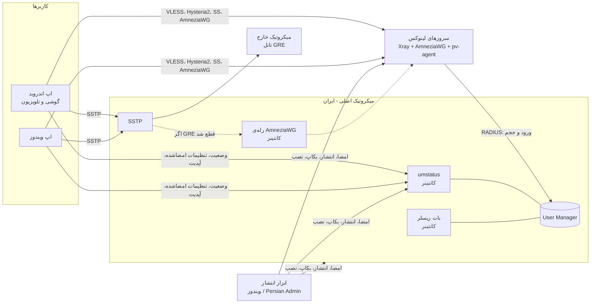

# Persian VPN

سرویس VPN با رابط فارسی، روی **یوزر منیجر میکروتیک**: اپ اندروید (گوشی و تلویزیون)، اپ ویندوز، چند پروتکل روی سرورهای لینوکس، و ابزار انتشار و مدیریت سرورها برای ویندوز و گوشی.

> مخزن خصوصی است. کلید امضای APK، کلید خصوصی امضای تنظیمات و رمزها **هرگز** در مخزن نیستند (پایین را ببینید).

## اجزا در یک نگاه

| پوشه | چیست |
|---|---|
| `app/` | اپ اندروید (کاتلین) بر پایه‌ی [Open SSTP Client](https://github.com/kittoku/Open-SSTP-Client) (MIT). کد اختصاصی در `app/src/main/java/kittoku/osc/brand/` |
| `mobile/pvcore/` | موتور Go مشترک اندروید و ویندوز (Xray، AmneziaWG، tun2socks، وصله‌ی bsdiff، اشتراک هات‌اسپات) |
| `mobile/cmd/pvwin/` | سرویس ویندوزی موتور (`pvwin.exe`) |
| `mobile/pvdiff/` | ساخت وصله‌ی bsdiff با Go برای نسخه‌ی گوشیِ ابزار انتشار |
| `windows/pvclient.py` | اپ ویندوز (PySide6) |
| `server/umstatus/` | سرویس وضعیت حساب، توزیع تنظیمات امضاشده، APK و وصله‌ها (کانتینر روی میکروتیک) |
| `server/linux/` | `pv_agent.py` (هماهنگی Xray و AmneziaWG با یوزر منیجر، حسابداری RADIUS) و سایت پوششی |
| `server/mikrotik/` | رله‌ی WireGuard→AmneziaWG برای تانل پشتیبان |
| `tools/release_tool/` | ابزار انتشار و مدیریت (ویندوز، PySide6) |
| `tools/admin_android/` | همان ابزار برای گوشی: **Persian Admin** (Flet) |
| `tools/sign_config.py` | امضای تنظیمات |

## مستندات

| سند | برای |
|---|---|
| [`docs/ARCHITECTURE_FA.md`](docs/ARCHITECTURE_FA.md) | تحلیل فنی: هر جزء چطور کار می‌کند، جریان داده‌ها، امنیت |
| [`docs/OPERATIONS_FA.md`](docs/OPERATIONS_FA.md) | کار روزمره: انتشار، تست، سرور جدید، بکاپ، تانل پشتیبان، رفع اشکال |
| [`docs/PROJECT_FA.md`](docs/PROJECT_FA.md) | وضعیت، امکانات و نقشه‌ی راه |
| [`docs/CHANGELOG_FA.md`](docs/CHANGELOG_FA.md) | تغییرات مهم |
| [`BUILD_FA.md`](BUILD_FA.md) | ساخت از صفر و راه‌اندازی اولیه |

بات ریسلر تلگرام در مخزن جدای [`um-reseller-bot`](https://github.com/taghvamohammad-art/um-reseller-bot) است.

## بیلدها (GitHub Actions)

| ورکفلو | خروجی |
|---|---|
| Build APK | اپ اندروید `persian-vpn-N` (گوشی و تلویزیون) |
| Mobile engine (pvcore.aar) | موتور Go برای اندروید |
| Windows client | اپ ویندوز |
| Release tool (Windows) | ابزار انتشار + تست‌های واقعی روی CHR و لینوکس |
| Admin app (Android) | Persian Admin `Persian-Admin-N` |

اگر حساب GitHub مشکل پرداخت داشته باشد، ورکفلوها اجرا نمی‌شوند؛ بعد از رفع، از Actions دستی «Run workflow» بزنید.

## هرگز در مخزن نگذارید
`release.jks` و رمزهایش (فقط در GitHub Secrets)، `config_key.private.json`، `server/umstatus/config.json`، `tools/config.json`، توکن GitHub و Cloudflare، رمز روترها. روی روتر فقط کلید **عمومی** (`config_key.public.txt`) می‌رود.

---

Original Open SSTP Client README:

# Open SSTP Client for Android 
This is an open-sourced Secure Socket Tunneling Protocol (MS-SSTP) client for Android, developed for accessing to 
[VPN Azure Cloud](https://www.vpnazure.net/) (or [SoftEther VPN Server](https://www.softether.org/)). 
So no test with other servers is done. Its behavior may be still unstable.

## Installation
You can download and install the latest version via [Google Play](https://play.google.com/store/apps/details?id=kittoku.osc).
Some of previous versions are released as apk file on [the releases page](https://github.com/kittoku/Open-SSTP-Client/releases).

## Usage
Enter `Host`, `Username` and `Password` preferences and turn the switch on. If a key icon gets to show on 
the right side of the status bar, establishing a VPN connection has been succeeded. To disconnect 
the connection, turn the switch off in the home tab or tap the notification. You can save/load the 
profile from the upper-right option menu.  
 

## Setting tab
Some settings to be noted are written below:

### Specify Trusted Certificates (SSL Layer)
If you choose a certain directory, the client uses ONLY certificates in the directory, but the default 
certificate store. I made this option for debugging.  
  
This preference is displayed as `Add Trusted Certificates` in v1.7.0 or older.

### PPP Network Protocol
You can choose what network protocol PPP layer tries enabling. Remember, IPv6 option just gives the device 
a link local address, never guarantees that you can communicate perfectly with IPv6 protocol.

### Custom DNS Server Address
You can specify DNS server to use in this option. Packets associated with this address is routed to 
the VPN tunnel. If you specify a IPv4(v6) address and disable IPv4(v6) network,
domain names possibly cannot be resolved.

### Enable App-Based Rule
With `Select Allowed/Disallowed Apps` option, you can specify the apps which can/cannot use the VPN tunnel.
Even allowed apps cannot use the VPN tunnel if their routes are not on the routing table.
So when you use this option, enabling `Add Default Route` option is recommended.

## Notice
* `Host` preference can also contain IP address, but cannot include a port number. You can configure it in
the setting tab.

* Your device needs to install a self-signed certificate and
 disable `Verify Hostname` option to access to a server using it
 
* A server must enable DHCP
 
* Only **PAP** and **MS-CHAPv2** authentication protocols can be enabled. No EAP. 
 
## Debugging
It is almost impossible that I can debug a problem caused in any environments but my own. In a networking
app, there are many possible reasons to cause the problem and I cannot identify the real one unless the 
problem can be reproduced in my environment.

So it is strongly encouraged that you should debug by yourself. With `Select Cipher Suites` option, this client tries 
to use `TLS_RSA_WITH_AES_128_CBC_SHA` or `TLS_RSA_WITH_AES_256_CBC_SHA` as a cipher suite so that you 
can decrypt and investigate packets with software like WireShark. I think there can be a similar app for 
Android. Don't forget the great software, Android Studio and its emulator (v^ー°)

I don't have Windows Server OS. So I don't officially support accessing to it, but there is a
 successful case. See [this issue](https://github.com/kittoku/Open-SSTP-Client/issues/8#issuecomment-590241322).

## License
Licensed under MIT. Be sure you use this software at your own risk. 

---
Branded fork: see BUILD_FA.md. Additions live in app/src/main/java/kittoku/osc/brand/
and tools/. The original MIT license (LICENSE) still applies to this code.
